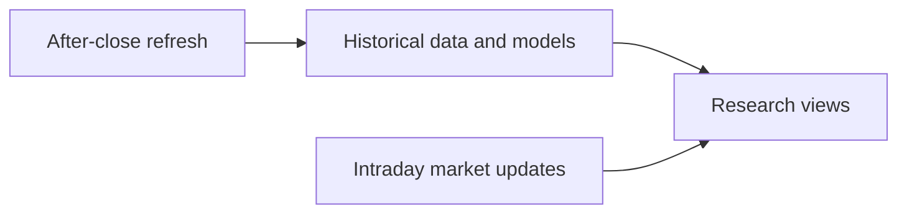

# StatsX | Commodity Derivatives Research Workbench

StatsX was a Python 3.8 and Windows research workbench archived in December 2024. It combined historical data refreshes with intraday commodity futures and options monitoring. Its views covered term structure, option premium, unusual options volume, and selected model outputs.

## How the workbench operated

- **After close.** Separate PowerShell entry points updated data and ran the daily models. The batch results provided context for the next session.
- **During the session.** A separate process collected live updates and computed intraday views. This kept the dashboard's refresh path separate from daily model jobs.
- **Storage and transport.** The workbench used MongoDB, ClickHouse, and Redis across historical storage, live storage, and message exchange.

The main engineering decision was to separate workloads by how fresh their inputs needed to be. The dashboard could combine historical reference data with intraday observations while the two refresh paths remained independently runnable. The preserved source and original commit history are held in a private archive.
