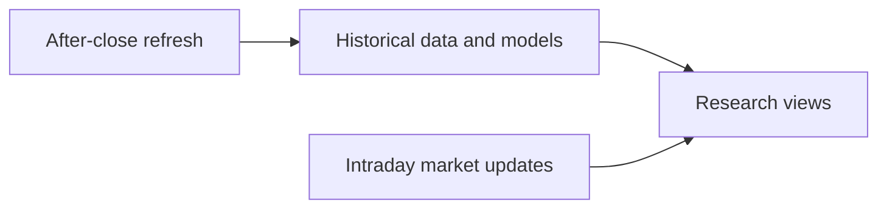

# StatsX | Commodity Derivatives Research Workbench

StatsX was a Python research workbench for commodity futures and options, archived in December 2024. It brought together after-close model outputs and intraday views of term structure, option premiums, and unusual option volume.

## From data refresh to research views

| Workflow | What it delivered |
| --- | --- |
| After close | Separate PowerShell jobs refreshed historical inputs and ran daily models. The results provided reference points for the next session. |
| During the session | A separate process collected market updates and computed intraday views. The dashboard could refresh these views independently of the daily batch jobs. |

The engineering decision was to split the workflows by how fresh their inputs needed to be. MongoDB, ClickHouse, and Redis supported storage and message exchange. The system ran on Windows with Python 3.8.

This repository documents the architecture as a case study. The source and original commit history are held in a private archive.
